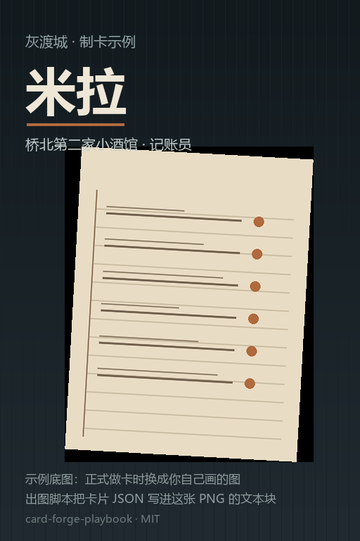

# card-forge-playbook

**给 AI agent 看的制卡流程包**：怎么做一张角色卡（卡片 JSON ＋ 世界书 JSON），怎么自检，怎么交付。
目标只有一个：**一个 agent 从零读完这一包，就能做出一张结构合格、能过检查器的卡。**
两端都讲：**SillyTavern** 与 **叙梦**（两边的字段读法与平台限制不一样，见 `05_输出端与平台.md`）。



*上面这张就是 `示例_最小卡包/` 跑 `node 工具/build_card.js 示例_最小卡包` 出的成品（底图是示例图，正式做卡换成你自己画的）。*

## 三步上手

0. **只要有 Node 18+**，零依赖、不用 `npm install`：`node 工具/check_all.js 示例_最小卡包` 应当打 `=== 结论：0 必须修 ===`（这是本库的自检，也是你验证环境的方式）。
1. 读 `AGENTS.md`（规矩）与 `01_流程.md`（七步流程）。**第一件事是想清楚：这张卡跑在哪个平台**（`05_输出端与平台.md`）。
2. 把 `示例_最小卡包/` 整个抄一份，改成你自己的卡（它是能跑通的最小样板）。
3. 每改一轮就跑 `node 工具/check_all.js <你的卡包目录>`，**跑到「0 必须修」才算这一步做完**。

## 一张卡＝两个文件

| 文件 | 是什么 | 谁读它 |
|---|---|---|
| `某卡_卡片.json` | 角色本体：名字／人设／开场白／示例对话 | SillyTavern 的角色卡（导出成 PNG 也是它） |
| `某卡_世界书.json` | 设定集：一条一条的「条目」，常驻或按关键词触发 | 世界书（World Info） |

**卡片管「她是谁」，世界书管「这个世界怎么运转」。** 写不下的大设定一律进世界书，不要塞进卡片字段。

## 目录导览

```
README.md            ← 你在这里
AGENTS.md            ← 给 agent 的硬规矩（先读这个）
01_流程.md           ← 七步：从定卡到交付
02_卡结构.md         ← 两个 JSON 的字段表与命名规范
03_检查器.md         ← 四个检查器 ＋ 总账 ＋ 出图脚本各查什么、期望读数
04_铁律与坑.md       ← 十一条踩过的坑（照着躲）
05_输出端与平台.md   ← 这张卡跑在哪：两端的位置编号、导入形态与平台限制
工具/                ← 可直接跑的检查器与出图脚本
模板/                ← 条目模板、术语表
示例_最小卡包/       ← 能跑通的最小样板，抄它
```

## 怎么让你的 agent 用它

把仓库地址丢给你的 agent，加一句：

> 把这个仓库读一遍（`AGENTS.md` → `01_流程.md` → 抄 `示例_最小卡包/`），然后照流程给我做一张卡：**<主题／角色／想要什么体验>**。卡要跑在 **<叙梦／SillyTavern／两个都要>** 上。每改一轮跑 `node 工具/check_all.js <卡包>`，跑到 0 必须修再来找我。

## 底线

- **跑不到全绿＝没做完**（`=== 结论：0 必须修 ===`）。
- **数字要能复算**：条目数、字数、编号都从文件里数出来，不许估。
- **不覆盖旧版**：出新版本号、旧版进 `_历史/`。
- **平台结论带前提**：平台／模型／预设／样本，四样缺一就别当成结论（见 `05_输出端与平台.md` 五）。
- 本库只讲**结构与流程**，不含任何具体卡的正文，也不含任何绕开平台规则的内容。

## 授权

MIT，见 `LICENSE`：随便用、随便改、随便再发，出事别找我。
